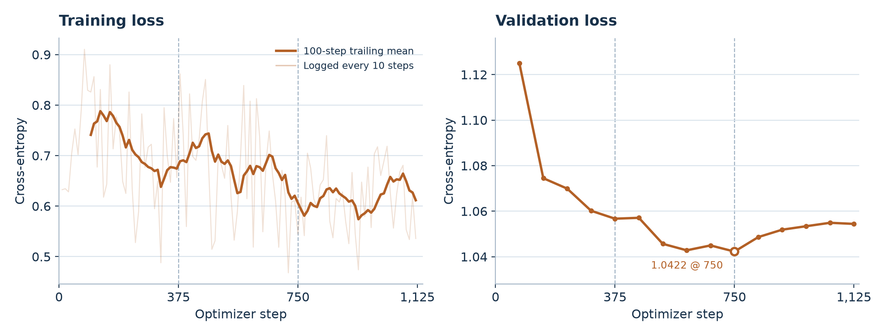
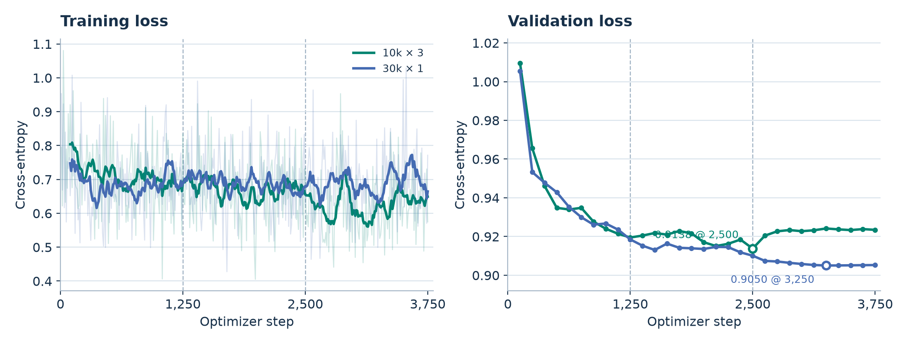

# 实验总结

## 我想比较什么

课堂组从 Qwen3-4B-Base 出发，用 3,000 条 Tülu 3 指令对话微调三轮，观察小规模 SFT 会改变哪些表现。进阶实验把重点放在数据怎么用上。如果约有 30,000 次样本处理机会，是把 10,000 条对话读三遍，还是读 30,000 条不同对话各一遍？

## 对照怎样设计

先随机抽取 30,000 条有效对话，再按来源、格式化后的输入长度和参与损失计算的回答长度，从中分层抽取 10,000 条。这样，两组的来源和长度分布接近，30k 包含 10k 的全部样本，还能额外接触 20,000 条对话。抽样以整段对话为单位，训练与验证按样本 ID 和标准化的用户消息排重，并排除与三个评测集存在直接文本匹配的样本。改写后的相似题目仍可能通过这项检查。

三组各自从同一个 Base 独立训练 LoRA，正式能力评测使用各自最后一步的适配器。两个进阶组共用 1,000 条留出对话，按相同步数做验证，可以直接比较曲线。课堂组的 300 条验证样本用于观察它自己的走势。三项能力评测对所有模型使用同一批题和相同的评分规则。

## 为什么用这些参数

| 参数选择 | 当时的考虑 |
|---|---|
| BF16 LoRA，秩 8，缩放参数 16 | 单卡上冻结基座，只更新约 0.41% 的参数。三个实验统一适配器设置，把对照集中在数据使用方式上。 |
| 单卡 batch 8，每批更新一次 | 固定每次更新处理的样本数。两组进阶实验各处理 30,000 次样本，因此都更新 3,750 步。 |
| AdamW，学习率 `1e-4`，前 10% 预热，随后余弦衰减 | 用同一套 LoRA 优化设置做对照。预热让更新从较小的步幅开始，后期逐渐缩小步幅。 |
| `qwen3_nothink`，格式化对话最长 2,048 token | 对所有训练样本使用同一序列格式和长度上限，覆盖用户提示、对话历史与参考回答。两个进阶组达到上限的样本比例都约为 4.8%。 |
| 3k 每 75 步验证，进阶组每 125 步验证 | 课堂组每轮得到 5 个验证点，进阶两组各有 30 个对齐的验证点，能看到轮次之间和轮次内部的变化。 |
| MMLU batch 4，GSM8K 和 IFEval batch 32 | MMLU 有较长的多选题提示，控制单次前向时的显存。GSM8K 短测里 32 比 64 更快，IFEval 的 64 虽更快，但显存峰值已接近卡的容量。 |

## 结果怎么看

### 课堂组微调前后

训练 loss 的轮均值逐轮下降，验证 loss 在第二轮末第 750 步达到 **1.0422**，第三轮结束回升到 **1.0544**。这是轻度过拟合的信号，模型继续改善对训练回答的拟合，留出样本上的损失已经开始回升。现有能力分数来自第三轮结束的模型。

IFEval 提示级严格准确率提高 **7.02 个百分点**，MMLU 小幅下降 **0.36 个百分点**。GSM8K 严格分数下降 **29.49 个百分点**，换成宽松提取后下降 **9.48 个百分点**。逐题看，3k 有 **372 道题**缺少严格规则所需的答案格式，但用宽松规则提取数字后判对。例如，有一道题的正确答案为 18，Base 写了 `#### 18`，3k 写的是 `The answer is 18.`。宽松规则下 3k 仍净少答对 125 题，保存的回答中也能找到实际计算错误。

[GSM8K 答案提取与判分分布](reports/figures/4-03-gsm8k-extraction.png)

### 10k×3 与 30k×1

| 全程统计 | 10k×3 | 30k×1 |
|---|---:|---:|
| 不同训练对话 | 10,000 | 30,000 |
| 非填充输入 token | 19,291,566 | 19,332,565 |
| 参与损失计算的 token | 13,337,139 | 13,412,290 |
| 最终共同验证 loss | 0.9234 | 0.9053 |

以 30k 组为参照，两类 token 的差分别为 **0.21%** 和 **0.56%**。第 2,500 步之后，10k 组开始第三遍学习同一批样本，训练 loss 继续下降，验证 loss 从 **0.9138** 回升至 **0.9234**。同一阶段的 30k 组继续接触新的对话，在共同验证集上的 loss 从 **0.9101** 降到 **0.9053**。

[进阶组的数据覆盖与训练 token 预算](reports/figures/4-04-advanced-token-budget.png)

30k 在 GSM8K 的严格和宽松分数上分别领先 **5.46** 和 **5.23** 个百分点，MMLU 小幅领先 **0.49** 个百分点。10k 的 IFEval 提示级严格分数高 **3.88** 个百分点，按题配对重采样的 95% 区间触及零。在本次训练里，增加数据覆盖最明显的收益出现在数学评测上。各组只训练一次，重复训练可以检验结果对随机种子的敏感性。

[同题分差与 95% 配对区间](reports/figures/4-06-paired-benchmark-differences.png) · [MMLU 各学科大类](reports/figures/4-07-mmlu-domains.png) · [IFEval 各类指令约束](reports/figures/4-08-ifeval-instruction-types.png)

## 下次值得记住

- **提前区分验证 loss 和能力分数。** 两个重复训练组的验证 loss 都在第二轮末最低。要知道第二轮是否也更会做评测题，需要单独评测第二轮的适配器。
- **按题检查生成任务的评分。** GSM8K 的分数既受到答案数值影响，也受到提取格式影响。结合严格、宽松分数和实际回答，更容易定位变化来自哪里。
- **并行评测会争用显存。** 3k 的 MMLU 首次并行运行时显存不足。GSM8K 完成后保留其结果，MMLU 按原来相同的模型、测试题、batch size 和计分规则单独补跑。

## 挑战任务的文献调研

- **LIMA（NeurIPS 2023）** 用 1,000 条人工精选的指令与回答做 SFT，说明少量精心整理的样本也能让模型学会多种回答形式。它给了我们一个从数据质量入手的理由。[LIMA 原论文](https://proceedings.neurips.cc/paper_files/paper/2023/hash/ac662d74829e4407ce1d126477f4a03a-Abstract-Conference.html)
- **AlpaGasus（ICLR 2024）** 用较强的语言模型为指令和回答评分，再筛掉低质量样本。它适合回答一个直接的问题：仅靠剔除低质量回答，能带来多少收益？[AlpaGasus 原论文](https://openreview.net/pdf/82bbc960a1e4d1d4a6bb4e485f84f7748f232df7.pdf)
- **LESS（ICML 2024）** 根据训练样本与目标示例的梯度相似性选数据。它适合定向改善某项能力，需要先选出代表该能力的参考示例。[LESS 原论文](https://proceedings.mlr.press/v235/xia24c.html)
- **MIG（Findings of ACL 2025）** 按候选样本能补充多少语义信息来选数据，兼顾质量和覆盖。论文在 Tülu 3 上比较了多种筛选方法，作者公开的数据也包含 DEITA 的质量与复杂度标注。[MIG 原论文](https://aclanthology.org/2025.findings-acl.515/) · [Tülu 3 标注](https://huggingface.co/datasets/xsample/tulu-3-pool-annotated)

我们的三个评测分别关注知识、数学和指令遵循，所以希望筛出一套覆盖多种任务的 10k 子集。**DEITA** 先结合指令复杂度和回答质量排序，再用语义相似度跳过近重复对话。这个方法适合在固定样本数下兼顾回答质量与覆盖，同时可以利用已有的 Tülu 3 标注。[DEITA 原论文](https://proceedings.iclr.cc/paper_files/paper/2024/file/6091f2bb355e960600f62566ac0e2862-Paper-Conference.pdf)

计划中的对照是让 DEITA 组和分层随机 10k 组都从同一个 Base 训练三轮，共用验证集和评测规则，先核对实际 token 预算，再比较三项评测和同题得失。挑战任务在本项目中停留在文献调研与对照设计阶段。
