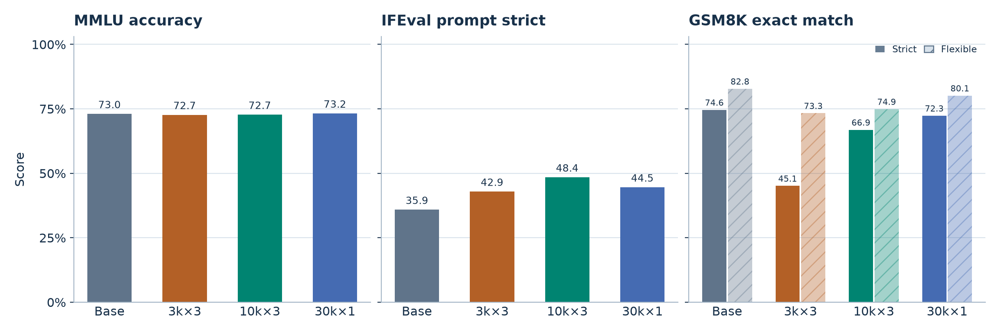

# Qwen3-4B-Base 监督微调实验

用 Tülu 3 指令对话对 Qwen3-4B-Base 做 BF16 LoRA 微调。课堂实验比较微调前后的模型表现，进阶实验在训练 token 预算接近时，比较重复学习已有对话与接触更多不同对话的效果。

| 模型 | 训练数据 | MMLU | IFEval 提示级严格 | GSM8K 严格 |
|---|---|---:|---:|---:|
| Base | 原始基座 | 73.02% | 35.86% | 74.60% |
| 3k×3 | 3,000 条，各看三次 | 72.66% | 42.88% | 45.11% |
| 10k×3 | 10,000 条，各看三次 | 72.72% | 48.43% | 66.87% |
| 30k×1 | 30,000 条，各看一次 | 73.22% | 44.55% | 72.33% |

3k×3 提升了指令遵循，GSM8K 的严格分数则明显下降，逐题记录显示答案格式和计算错误都影响了得分。进阶两组的输入 token 仅差 0.21%，30k×1 的共同验证集 loss 更低，GSM8K 更高，10k×3 在本次 IFEval 得分更高。

- [实验总结](EXPERIMENT_NOTES.md)记录对照设计、参数选择、结果解释和容易踩的坑。
- [复现说明](REPRODUCE.md)给出独立环境、输入准备和训练评测命令。
- [训练配置](configs/)和[实验脚本](scripts/)对应三组正式实验。

微调使用 LLaMA-Factory，评测使用 lm-evaluation-harness。复现脚本按固定版本下载公开基座和数据，在本地重新构造训练集。[Qwen3-4B-Base](https://huggingface.co/Qwen/Qwen3-4B-Base) · [Tülu 3 SFT 数据](https://huggingface.co/datasets/allenai/tulu-3-sft-mixture)
